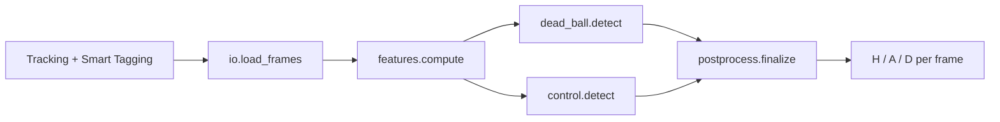

# lositalianos+1 — Technical document, More than a Hack 2027 Phase 1

*A few pages. Owner: external data + doc (@marcodonghiaa). Every owner adds notes to their section
as they go; `TODO(<owner>)` marks what is still missing. Scores are filled in from the board at the
end, each with its labels version.*

**Summary.** We label every frame of the tactical video `H` (Barcelona), `A` (Athletic), `D` (dead
ball) with a rule-based pipeline on the provided tracking: detect dead ball, find which team
controls the ball, then smooth into stable possessions. No model is trained. Every number is set by
football reasoning or tuned on 20 open SkillCorner matches converted to our format, never on the
provided game.

## 1. Approach

What we built and why: possession is scored by whole possessions (spellF1), so a stable, correctly
timed run matters more than per-frame accuracy. We therefore keep each step simple and explainable
and put the effort into stability (post-processing) and into an honest external test set.



| Step | Module | Owner | One-line method |
|---|---|---|---|
| Load | `possession/io.py` | Pietro | TODO(@pietrodianaa) |
| Features | `possession/features.py` | Pietro | TODO(@pietrodianaa) |
| Dead ball | `possession/dead_ball.py` | Edoardo | TODO(@edoardoaratri-blip) |
| Control | `possession/control.py` | Damiano | TODO(@damigiana) |
| Post-processing | `possession/postprocess.py` | Pietro | Hysteresis smoother: a switch needs `SWITCH_CONFIRM_S` of evidence and is dated back to the turnover |

Why each role is scored on its own: `possession/scores.py` replaces every other role with the truth,
so a change in one module is measured without noise from the others.

## 2. Assets used

| Asset | Used? | How |
|---|---|---|
| Tracking (ball + 46 track slots, 25 fps) | yes | input to every step |
| Smart Tagging (phases, set pieces) | TODO(@edoardoaratri-blip) | evidence for dead ball, not truth |
| Homography / pitch size | yes | pitch dimensions for out-of-bounds |
| Video | no | not used as input; never used to check output |
| Public 5-minute ground truth | no | not used for tuning or checking |

Tried and dropped: TODO (collected from every `experiments/<name>/LOG.md` row marked not kept).

## 3. Training and tuning data

No model is trained. Numbers that are not set by football reasoning are tuned with
`python run.py --tune` on external data only.

**SkillCorner Open Data** — broadcast tracking (players and ball, 10 fps), Dynamic Events and
Phases of Play for 20 Australian A-League 2024/25 matches.
- Source: <https://github.com/SkillCorner/opendata>, pinned commit `4340d274` (fetched by
  `tools/get_external_data.sh`; the data is never committed to this repository).
- Licence: MIT, © 2020 SkillCorner. Data by [SkillCorner](https://skillcorner.com), released with
  [PySport](https://pysport.org/). We thank SkillCorner for making it open.
- Who labelled it: nobody on our team. Possession labels are derived **by code** from SkillCorner's
  automatic Phases of Play (`possession/external.py`); no person decided any label.
- How much: 20 full matches, labels version 1 (`external.LABELS_VERSION`).

### 3.1 Conversion to our format (labels v1)

| Choice | Rule | Why |
|---|---|---|
| Team in possession | the phase's `team_in_possession` for every frame of a phase of play | SkillCorner phases already keep possession through loose balls and touches, as our rules require |
| Dead ball | every gap between two phases in the same half = `D` | gaps are stoppages; no SkillCorner player possession falls inside any gap (check below) |
| Not graded | untracked frames (replays) and frames outside the halves = `X` | no evidence there; outside the halves is not graded in the challenge either |
| Frame rate | 10 → 25 fps; positions by linear interpolation between valid samples, labels by nearest frame | our submission is at 25 fps; interpolation never bridges a missing sample |
| Speeds | recomputed from positions at 25 fps | same definition on both data sets |
| Ball degradation | SkillCorner's undetected ball is missing; then seeded 1 s bursts until ~41% of graded frames miss the ball | matches the ~41% missing ball of our match (DATA.md); fixed seed so every teammate sees the same input |
| Teams | `H` = SkillCorner's `home_team` in `match.json`, `A` = the other | same home/away convention as our match |

Checks of these rules on all 20 games (`experiments/marco/phase_check.py`, SkillCorner events
only):
- 2,035 gaps between phases; none contains a SkillCorner player possession, so `D` in the gaps
  never hides play.
- 268 of 18,710 player possessions (1.4%) sit wholly inside the other team's phase; median length
  0.1 s, i.e. touches, deflections and clearances, which under our rules do not change possession.
  Only 13 last 2 s or more (32 s in 20 games).
- At restarts the phase team is the team taking the restart in 1,573 of 1,628 cases (96.6%).
- Teammates rebuild identical labels: `tools/get_external_data.sh` checks a digest of truth and
  ball mask.

### 3.2 Known differences from our match
- SkillCorner gives every player a fixed identity (extrapolated when off camera); our track slots
  are fragments that appear, vanish and swap. Methods that rely on player identity may look better
  on external data than on ours.
- Broadcast camera vs tactical camera: off-camera positions are extrapolated by SkillCorner.
- No Smart Tagging on external matches (`tags = []`), so tag-based dead-ball evidence is not
  measured there.

## 4. Compliance with the rules clarification (3 Nov 2026)
- No training, fitting or tuning on the ground truth, the public 5 minutes, the video or the
  provided game. Every number in the code states its source on its line
  (`# source: football reasoning: …` or `# source: external v<N>: …`). Table: TODO (generated from
  the `# source:` lines at the end).
- External data used for tuning: section 3.
- No hand-made data about the match. No checking of our output against the video.
- AI tools: TODO(all) — which assistants each of us used, and for what (code, docs, `--tune` on
  external data). They never received the provided data: the repository rules forbid
  agents from reading `data/`, `cache/`, `evaluation/gt/`, results or submissions, and humans run
  anything on the real match. Disclosure: on Oct 31, before the rules clarification, an AI
  assistant briefly read the tracking metadata (BAR-ATH_tactical_atd.xml) and the Smart Tagging
  file to explain their format; the copies were deleted and nothing was used for training or
  tuning.

## 5. Possession rules implemented
- Dead ball: TODO(@edoardoaratri-blip) — out of bounds, ball stopped before a restart, set-piece tags.
- Control and change of possession: TODO(@damigiana) — what counts as control vs a touch,
  deflection, block or aerial duel; loose balls stay with the last team.
- Restarts: the restart owner gets possession when play resumes. TODO(@edoardoaratri-blip)
- Smoothing and abstention (`X`): TODO(@pietrodianaa).

## 6. Results on external data
Each role's own score (other roles replaced by truth), then the joint end-to-end score, all on
labels v1 unless stated. Differences under ~0.04 spellF1 are noise.

| Role | Metric | Baseline | Current | Labels version |
|---|---|---|---|---|
| Control | spellF1 | 0.4542 | 0.6498 (#15) | 1 |
| Post-processing | spellF1 | 0.8469 | TODO | 1 |
| Dead ball | D F1 | 0.0 (disabled) | TODO | 1 |
| Full pipeline | spellF1 | TODO | TODO (milestone run) | 1 |

What each component added: TODO from the `LOG.md` files.

## 7. Limitations
- External matches differ from ours (section 3.2), so external scores are a guide, not a promise.
- TODO: where each step fails, and what we would fix with more time (one line per owner).

## 8. Reproduction
```bash
pip install -r requirements-team.txt
# put the data bundle in data/ (see DATA.md)
python run.py --final        # -> submissions/lositalianos+1.csv
# optional: rebuild the external practice set and check the digest
tools/get_external_data.sh
python run.py --tune --role full
```
