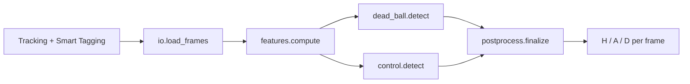

# lositalianos+1 — Technical document, More than a Hack 2027 Phase 1

*A few pages. Owner: external data + doc (@marcodonghiaa). Every owner adds notes to their section
as they go; `TODO(<owner>)` marks what is still missing. Scores are filled in from the board at the
end, each with its labels version.*

**Summary.** We label every frame of the tactical video `H` (Barcelona), `A` (Athletic), `D` (dead
ball) with a rule-based pipeline on the provided tracking: detect dead ball, find which team
controls the ball, then smooth into stable possessions. No model is trained. Every number is set by
football reasoning or tuned on 20 open SkillCorner matches converted to our format, never on the
provided game.

## 1. Approach

What we built and why: possession is scored by whole possessions (spellF1), so a stable, correctly
timed run matters more than per-frame accuracy. We therefore keep each step simple and explainable
and put the effort into stability (post-processing) and into an honest external test set.



| Step | Module | Owner | One-line method |
|---|---|---|---|
| Load | `possession/io.py` | Pietro | Parse tracking once into per-frame arrays indexed by video frame (ball, 46 track slots, speeds, team, half, pitch size); cached |
| Features | `possession/features.py` | Pietro | Ball visibility, distance of every slot to the ball, nearest team and nearest home/away distance; `ball_v2` fills ball gaps of at most 1 s with a straight line |
| Dead ball | `possession/dead_ball.py` | Edoardo | Ball out over a line, dead until the restart; ball still with nobody on it after a whistle |
| Control | `possession/control.py` | Damiano | Close, clear contact with the ball held for 0.5 s counts as control; a loose ball stays with the last controller for up to 5 s |
| Post-processing | `possession/postprocess.py` | Pietro | Hysteresis smoother: a switch needs `SWITCH_CONFIRM_S` of evidence and is dated back to the turnover |

Why each role is scored on its own: `possession/scores.py` replaces every other role with the truth,
so a change in one module is measured without noise from the others.

## 2. Assets used

| Asset | Used? | How |
|---|---|---|
| Tracking (ball + 46 track slots, 25 fps) | yes | input to every step |
| Smart Tagging (phases, set pieces) | no (not yet) | the pipeline accepts tags but no step reads them; set-piece tags are a planned dead-ball cue |
| Homography / pitch size | yes | pitch dimensions for out-of-bounds |
| Video | no | not used as input; never used to check output |
| Public 5-minute ground truth | no | not used for tuning or checking |

Tried and dropped (from the team's `experiments/<name>/LOG.md` files, all measured on external data):
- Control: a longer confirmation (0.8–1.0 s) misses quick turnovers; a shorter loose-ball hold
  (2–3 s) leaves gaps; a 2 m contact radius misses receptions; an unlimited hold gave no gain and
  would carry a team across long blind gaps.
- Post-processing: turning every blind gap longer than 8 s into dead ball. It was a stopgap from
  before dead-ball detection existed; dropping it raised the post-processing score from 0.8469 to
  0.8653, because a ball the tracker cannot see is still in play.
- Dead ball: a 1 m margin past the line (0.25 m is better and still above tracking noise); ending
  a dead run as soon as the ball is seen again (it now lasts until the restart).

## 3. Training and tuning data

No model is trained. Numbers that are not set by football reasoning are tuned with
`python run.py --tune` on external data only.

**SkillCorner Open Data** — broadcast tracking (players and ball, 10 fps), Dynamic Events and
Phases of Play for 20 Australian A-League 2024/25 matches.
- Source: <https://github.com/SkillCorner/opendata>, pinned commit `4340d274` (fetched by
  `tools/get_external_data.sh`; the data is never committed to this repository).
- Licence: MIT, © 2020 SkillCorner. Data by [SkillCorner](https://skillcorner.com), released with
  [PySport](https://pysport.org/). We thank SkillCorner for making it open.
- Who labelled it: nobody on our team. Possession labels are derived **by code** from SkillCorner's
  automatic Phases of Play (`possession/external.py`); no person decided any label.
- How much: 20 full matches, labels version 1 (`external.LABELS_VERSION`).

### 3.1 Conversion to our format (labels v1)

| Choice | Rule | Why |
|---|---|---|
| Team in possession | the phase's `team_in_possession` for every frame of a phase of play | SkillCorner phases already keep possession through loose balls and touches, as our rules require |
| Dead ball | every gap between two phases in the same half = `D` | gaps are stoppages; no SkillCorner player possession falls inside any gap (check below) |
| Not graded | untracked frames (replays) and frames outside the halves = `X` | no evidence there; outside the halves is not graded in the challenge either |
| Frame rate | 10 → 25 fps; positions by linear interpolation between valid samples, labels by nearest frame | our submission is at 25 fps; interpolation never bridges a missing sample |
| Speeds | recomputed from positions at 25 fps | same definition on both data sets |
| Ball degradation | SkillCorner's undetected ball is missing; then seeded 1 s bursts until ~41% of graded frames miss the ball | matches the ~41% missing ball of our match (DATA.md); fixed seed so every teammate sees the same input |
| Teams | `H` = SkillCorner's `home_team` in `match.json`, `A` = the other | same home/away convention as our match |

Checks of these rules on all 20 games (`experiments/marco/phase_check.py`, SkillCorner events
only):
- 2,035 gaps between phases; none contains a SkillCorner player possession, so `D` in the gaps
  never hides play.
- 268 of 18,710 player possessions (1.4%) sit wholly inside the other team's phase; median length
  0.1 s, i.e. touches, deflections and clearances, which under our rules do not change possession.
  Only 13 last 2 s or more (32 s in 20 games).
- At restarts the phase team is the team taking the restart in 1,573 of 1,628 cases (96.6%).
- Teammates rebuild identical labels: `tools/get_external_data.sh` checks a digest of truth and
  ball mask.

### 3.2 Known differences from our match
- SkillCorner gives every player a fixed identity (extrapolated when off camera); our track slots
  are fragments that appear, vanish and swap. Methods that rely on player identity may look better
  on external data than on ours.
- Broadcast camera vs tactical camera: off-camera positions are extrapolated by SkillCorner.
- No Smart Tagging on external matches (`tags = []`), so tag-based dead-ball evidence is not
  measured there.

## 4. Compliance with the rules clarification (3 Nov 2026)
- No training, fitting or tuning on the ground truth, the public 5 minutes, the video or the
  provided game. Every number in the code states its source on its line
  (`# source: football reasoning: …` or `# source: external v<N>: …`). The table in Appendix A
  lists them; the full reason is on each line of the code.
- External data used for tuning: section 3.
- No hand-made data about the match. No checking of our output against the video.
- AI tools, as each of us declared them:
  - Pietro: Claude (Claude Code) for code, docs, the team board and `--tune` on external data only.
  - Damiano: Claude Code (Anthropic) for `possession/control.py`, its tests, `--tune` on the
    external practice games only and board posts; the Edge skill search to look up published
    methods. No other AI tools.
  - Marco: Claude Code for the external practice set, this document and board posts. No other AI
    tools.
  - Edoardo: TODO(@edoardoaratri-blip).

  They never received the provided data: the repository rules forbid
  agents from reading `data/`, `cache/`, `evaluation/gt/`, results or submissions, and humans run
  anything on the real match. Disclosure: on Oct 31, before the rules clarification, an AI
  assistant briefly read the tracking metadata (BAR-ATH_tactical_atd.xml) and the Smart Tagging
  file to explain their format; the copies were deleted and nothing was used for training or
  tuning.

## 5. Possession rules implemented
- **Dead ball, ball out.** The ball is out when it is more than 0.25 m past a touchline or byline
  (the whole ball has crossed, plus a buffer for tracking noise). The dead run starts where the
  ball crossed the line and lasts until the restart: the ball moves fast again (over 4 m/s, a throw
  or a kick) or is seen more than 6 m inside every line. While the tracker has lost the ball after
  an out, play stays dead for at most 40 s and never across halves.
- **Dead ball, stoppage in the field (fouls, offsides).** The ball moves less than 1 m in 1 s,
  nobody is within 1.5 m of it (the taker steps away; a keeper holding the ball or a player with
  it at his feet is not a stoppage) and players walk (under 2.5 m/s on average), for at least 3 s.
  Short tracker gaps where the ball reappears on the same spot are bridged. Quick free kicks taken
  within 1–3 s are missed on purpose: they look like a player controlling the ball in open play.
- **Glitches.** Any dead run shorter than 2 s is dropped; a real stoppage lasts longer.
- **Control.** A team is in contact when its nearest player is within 2.5 m of the visible ball
  and at least 0.5 m nearer than the nearest opponent. Contact becomes control only if the same team
  keeps it for 0.5 s without a break, so a single touch, a deflection, a block or an aerial duel
  won without control gives no evidence for the other team.
- **Loose balls.** After the last confirmed control, the ball stays with that team for up to 5 s
  (pass in flight, bounce, ball briefly unseen). Beyond that the control step gives no evidence,
  and post-processing keeps the last team.
- **Change of possession.** Post-processing holds the current team and switches only after the
  other team has 1 s of control evidence with no evidence for the current team in between. The
  switch is dated back to the other team's first frame, so the turnover is placed where it happened.
- **Restarts.** A dead run ends the possession. The frames from the restart until the next control
  evidence get that evidence's team, so the team that takes the restart and keeps the ball owns
  the new possession.
- **Abstention (`X`).** The current version never outputs `X`: every frame is `H`, `A` or `D`.

## 6. Results on external data
Each role's own score (other roles replaced by truth), then the joint end-to-end score, all on
labels v1 unless stated. Differences under ~0.04 spellF1 are noise.

| Role | Metric | Baseline | Current | Labels version |
|---|---|---|---|---|
| Control | spellF1 | 0.4542 | 0.6498 (#15) | 1 |
| Post-processing | spellF1 | 0.8469 | 0.8653 (#25) | 1 |
| Dead ball | D F1 | 0.0 (disabled) | 0.5896 (#23; precision 0.9228, recall 0.4353) | 1 |
| Full pipeline | spellF1 | TODO | TODO (milestone run) | 1 |

What each component added (own role score, labels v1):
- Control: contact radius and clear margin 0.4542 → 0.5099; 0.5 s confirmation plus 5 s
  loose-ball hold → 0.6498. Even and odd games give 0.659 and 0.641, so the gain is not luck of
  the split.
- Dead ball: ball out over a line 0.0 → 0.4144; margin 1.0 → 0.25 m 0.4858; dead until the restart
  0.5451; ball still after a whistle 0.5896. Precision stays above 0.91 throughout.
- Post-processing: hysteresis instead of the baseline majority vote; dropping the 8 s
  blind-gap rule 0.8469 → 0.8653.

## 7. Limitations
- External matches differ from ours (section 3.2), so external scores are a guide, not a promise.
- The practice set is A-League, the league with the fewest fouls (19.7 per game against 24.6 in
  LaLiga, CIES, Mar 2024–Mar 2025). Foul stoppages are rarer there, so tuning probably
  under-rewards the ball-still rule.
- Dead ball finds about 44% of true dead frames on external data (recall 0.4353). Before the
  ball-still rule, most missed stoppages were stops with the ball in the field (fouls, offsides);
  quick free kicks are still missed on purpose.
- Some dead runs touch no true stoppage (26 in 20 games, 1.3 per game, measured at dead ball
  v1.2). Each one splits a possession.
- Control only uses the visible ball. Long stretches with the ball unseen (aerial balls, crowded
  areas) keep the last team, which is wrong when the ball changed hands while unseen.
- Smart Tagging is not used yet; its set-piece intervals would mark restarts directly.
- With more time: set-piece tags as dead-ball evidence, the kick-off shape after goals, and a
  team-shape signal for frames where the ball is not seen.

## 8. Reproduction
```bash
pip install -r requirements-team.txt
# put the data bundle in data/ (see DATA.md)
python run.py --final        # -> submissions/lositalianos+1.csv
# optional: rebuild the external practice set and check the digest
tools/get_external_data.sh
python run.py --tune --role full
```

## Appendix A. Source of every number

Collected from the `# source:` lines on `main` (the scoring code, `possession/scores.py`, is
left out because it is not part of the labelling pipeline). "external v1" means tuned with `python run.py --tune` on the
SkillCorner practice set, labels v1; most of those also give the football reason for the range.

| File | Name | Value | Source |
|---|---|---|---|
| `config.py` | `FPS` | `25` | data format |
| `config.py` | `N_FRAMES` | `199319` | data format |
| `config.py` | `PITCH` | `(105.3, 68.0)` | data format |
| `config.py` | `KPH_TO_MS` | `1 / 3.6` | data format |
| `control.py` | `METHOD` | `"v1"` | issue #9 |
| `control.py` | `CONTROL_RADIUS_M` | `2.5` | football reasoning, external v1 |
| `control.py` | `CLEAR_MARGIN_M` | `0.5` | football reasoning, external v1 |
| `control.py` | `CONFIRM_S` | `0.5` | football reasoning, external v1 |
| `control.py` | `HOLD_S` | `5.0` | football reasoning, external v1 |
| `dead_ball.py` | `ENABLED` | `True` | football reasoning |
| `dead_ball.py` | `MARGIN_M` | `0.25` | football reasoning, external v1 |
| `dead_ball.py` | `MAX_FILL_S` | `40.0` | football reasoning, external v1 |
| `dead_ball.py` | `MIN_DEAD_S` | `2.0` | football reasoning, external v1 |
| `dead_ball.py` | `HOLD_UNTIL_RESTART` | `True` | football reasoning, external v1 |
| `dead_ball.py` | `SPEED_WINDOW_S` | `0.2` | football reasoning |
| `dead_ball.py` | `RESTART_SPEED_MS` | `4.0` | football reasoning, external v1 |
| `dead_ball.py` | `RESTART_ZONE_M` | `6.0` | football reasoning, external v1 |
| `dead_ball.py` | `STILL_ENABLED` | `True` | football reasoning, external v1 |
| `dead_ball.py` | `STILL_WINDOW_S` | `1.0` | football reasoning, external v1 |
| `dead_ball.py` | `STILL_SPEED_MS` | `1.0` | football reasoning, external v1 |
| `dead_ball.py` | `STILL_CLEAR_M` | `1.5` | football reasoning, external v1 |
| `dead_ball.py` | `STILL_PLAYERS_MS` | `2.5` | football reasoning, external v1 |
| `dead_ball.py` | `STILL_MIN_S` | `3.0` | football reasoning, external v1 |
| `dead_ball.py` | `STILL_BRIDGE_S` | `2.0` | football reasoning, external v1 |
| `dead_ball.py` | `STILL_BRIDGE_M` | `1.0` | football reasoning |
| `dead_ball.py` | `STILL_BACKDATE` | `True` | football reasoning, external v1 |
| `external.py` | `LABELS_VERSION` | `1` | bookkeeping |
| `external.py` | `SC_FPS` | `10` | data format |
| `external.py` | `MASK_SEED` | `0` | bookkeeping |
| `external.py` | `BALL_MISSING_SHARE` | `0.41` | DATA.md |
| `external.py` | `BALL_MISSING_BURST_S` | `1.0` | football reasoning |
| `features.py` | `BALL_GAP_MAX_S` | `1.0` | football reasoning |
| `features.py` | `BALL_MAX_SPEED_MS` | `35.0` | football reasoning |
| `postprocess.py` | `SMOOTH_WINDOW` | `50` | official baseline default |
| `postprocess.py` | `METHOD` | `"hysteresis"` | football reasoning |
| `postprocess.py` | `SWITCH_CONFIRM_S` | `1.0` | football reasoning |
| `postprocess.py` | `LONG_GAP_DEAD_S` | `None` | football reasoning |
