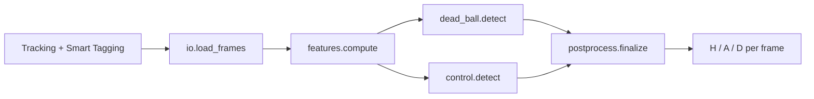

# lositalianos+1 — Technical document, More than a Hack 2027 Phase 1

*A few pages. Owner: external data + doc (@marcodonghiaa); each section was written with or
checked by the owner of that module. State at the code freeze (Nov 15, 2026, main `9ef384c`);
every score gives its labels version.*

**Summary.** We label every frame of the tactical video `H` (Barcelona), `A` (Athletic), `D` (dead
ball) with a rule-based pipeline on the provided tracking: detect dead ball, find which team
controls the ball, then smooth into stable possessions. No model is trained. Every number is set by
football reasoning or tuned on 20 open SkillCorner matches converted to our format, never on the
provided game.

## 1. Approach

What we built and why: possession is scored by whole possessions (spellF1), so a stable, correctly
timed run matters more than per-frame accuracy. We therefore keep each step simple and explainable
and put the effort into stability (post-processing) and into an honest external test set.



| Step | Module | Owner | One-line method |
|---|---|---|---|
| Load | `possession/io.py` | Pietro | Parse tracking once into per-frame arrays indexed by video frame (ball, 46 track slots, speeds, team, half, pitch size); cached |
| Features | `possession/features.py` | Pietro | Ball visibility, distance of every slot to the ball, nearest team and nearest home/away distance; `ball_v2` fills ball gaps of at most 1 s with a straight line |
| Dead ball | `possession/dead_ball.py` | Edoardo | Ball out over a line (seen, or lost next to a line and back at a restart spot), dead from the last touch until the restart; play stopped in the field (ball still, or everyone walking); kick-off shape; set-piece tags |
| Control | `possession/control.py` | Damiano | Close, clear contact with the ball held for 0.5 s counts as control; a loose ball stays with the last controller for up to 5 s; with no ball evidence, the team covering more pitch is taken as in possession |
| Post-processing | `possession/postprocess.py` | Pietro | Hysteresis smoother: a switch needs 1 s of evidence and is dated back to the turnover; right after a restart, 0.6 s of evidence corrects the restart team |

Why each role is scored on its own: `possession/scores.py` replaces every other role with the truth,
so a change in one module is measured without noise from the others.

## 2. Assets used

| Asset | Used? | How |
|---|---|---|
| Tracking (ball + 46 track slots, 25 fps) | yes | input to every step |
| Smart Tagging (phases, set pieces) | yes, set pieces only | reinforcement for dead ball (section 5); never used as truth |
| Homography / pitch size | yes | pitch dimensions for out-of-bounds |
| Video | no | not used as input; never used to check output |
| Public 5-minute ground truth | no | not used for tuning or checking |

Tried and dropped (from the team's `experiments/<name>/LOG.md` files, all measured on external data):
- Control: a longer confirmation (0.8–1.0 s) misses quick turnovers; a shorter loose-ball hold
  (2–3 s) leaves gaps; a 2 m contact radius misses receptions; an unlimited hold gave no gain and
  would carry a team across long blind gaps.
- Post-processing: turning every blind gap longer than 8 s into dead ball. It was a stopgap from
  before dead-ball detection existed; dropping it raised the post-processing score from 0.8469 to
  0.8653, because a ball the tracker cannot see is still in play.
- Post-processing: a longer switch wait (1.5 s 0.8072, 2.0 s 0.7449, against 0.8735 at 1.0 s);
  a shorter wait plus merging spells under 1 s (0.8938, but more spells, which could worsen the
  over-splitting the joint check shows). The merge option stays in the code, off.
- Dead ball: a 1 m margin past the line (0.25 m is better); ending a dead run as soon as the ball
  is seen again (it now lasts until the restart); a 3 s minimum dead run (fewer false runs, more
  real stops lost); a stricter restart (more possessions swallowed); a foul spot from a duel at the
  ball before everyone walks (gain within noise, more false runs); requiring players to slow down
  after an out (loses more real outs than false ones); longer backdates to the last touch, 2–5 s
  (no better on the possession checks, more possessions swallowed); a shorter, looser walk near a
  goal or a line (more false dead runs in slow open play); a wall at free kicks (already caught by
  the ball-still and walking rules); other smoothing windows and pass speeds for the walking rule
  (no gain beyond noise on the possession checks).

## 3. Training and tuning data

No model is trained. Numbers that are not set by football reasoning are tuned with
`python run.py --tune` on external data only.

**SkillCorner Open Data** — broadcast tracking (players and ball, 10 fps), Dynamic Events and
Phases of Play for 20 Australian A-League 2024/25 matches.
- Source: <https://github.com/SkillCorner/opendata>, pinned commit `4340d274` (fetched by
  `tools/get_external_data.sh`; the data is never committed to this repository).
- Licence: MIT, © 2020 SkillCorner. Data by [SkillCorner](https://skillcorner.com), released with
  [PySport](https://pysport.org/). We thank SkillCorner for making it open.
- Who labelled it: nobody on our team. Possession labels are derived **by code** from SkillCorner's
  automatic Phases of Play (`possession/external.py`); no person decided any label.
- How much: 20 full matches, labels version 1 (`external.LABELS_VERSION`).

### 3.1 Conversion to our format (labels v1)

| Choice | Rule | Why |
|---|---|---|
| Team in possession | the phase's `team_in_possession` for every frame of a phase of play | SkillCorner phases already keep possession through loose balls and touches, as our rules require |
| Dead ball | every gap between two phases in the same half = `D` | gaps are stoppages; no SkillCorner player possession falls inside any gap (check below) |
| Not graded | untracked frames (replays) and frames outside the halves = `X` | no evidence there; outside the halves is not graded in the challenge either |
| Frame rate | 10 → 25 fps; positions by linear interpolation between valid samples, labels by nearest frame | our submission is at 25 fps; interpolation never bridges a missing sample |
| Speeds | recomputed from positions at 25 fps | same definition on both data sets |
| Ball degradation | SkillCorner's undetected ball is missing; then seeded 1 s bursts until ~41% of graded frames miss the ball | matches the ~41% missing ball of our match (DATA.md); fixed seed so every teammate sees the same input |
| Teams | `H` = SkillCorner's `home_team` in `match.json`, `A` = the other | same home/away convention as our match |

Checks of these rules on all 20 games (`experiments/marco/phase_check.py`, SkillCorner events
only):
- 2,035 gaps between phases; none contains a SkillCorner player possession, so `D` in the gaps
  never hides play.
- 268 of 18,710 player possessions (1.4%) sit wholly inside the other team's phase; median length
  0.1 s, i.e. touches, deflections and clearances, which under our rules do not change possession.
  Only 13 last 2 s or more (32 s in 20 games).
- At restarts the phase team is the team taking the restart in 1,573 of 1,628 cases (96.6%).
- Teammates rebuild identical labels: `tools/get_external_data.sh` checks a digest of truth and
  ball mask.

### 3.2 Known differences from our match
- SkillCorner gives every player a fixed identity (extrapolated when off camera); our track slots
  are fragments that appear, vanish and swap. Methods that rely on player identity may look better
  on external data than on ours.
- Broadcast camera vs tactical camera: off-camera positions are extrapolated by SkillCorner.
- No Smart Tagging on external matches (`tags = []`), so the set-piece rule is not measured by
  `--tune`; it was checked in a simulation with fake tags built from the external labels
  (section 6).

## 4. Compliance with the rules clarification (3 Nov 2026)
- No training, fitting or tuning on the ground truth, the public 5 minutes, the video or the
  provided game. Every number in the code states its source on its line
  (`# source: football reasoning: …` or `# source: external v<N>: …`). The table in Appendix A
  lists them; the full reason is on each line of the code.
- External data used for tuning: section 3.
- No hand-made data about the match. No checking of our output against the video.
- AI tools, as each of us declared them:
  - Pietro: Claude (Claude Code) for code, docs, the team board and `--tune` on external data only.
  - Damiano: Claude Code (Anthropic) for `possession/control.py`, its tests, `--tune` on the
    external practice games only and board posts; the Edge skill search to look up published
    methods. No other AI tools.
  - Marco: Claude Code for the external practice set, this document and board posts. No other AI
    tools.
  - Edoardo: Claude (Anthropic) for `possession/dead_ball.py`, the scratch sweep and diagnosis
    scripts in `experiments/edoardo/`, board posts and public web research (Opta, IFAB, CIES
    statistics); `--tune` and the scripts ran on the external practice games only; the Edge skill
    search (no skill used). No other AI tools.

  Each of us confirmed that none of these tools received the provided data, the video or the
  ground truth: the repository rules forbid
  agents from reading `data/`, `cache/`, `evaluation/gt/`, results or submissions, and humans run
  anything on the real match. Disclosure: on Oct 31, before the rules clarification, an AI
  assistant briefly read the tracking metadata (BAR-ATH_tactical_atd.xml) and the Smart Tagging
  file to explain their format; the copies were deleted and nothing was used for training or
  tuning.

## 5. Possession rules implemented
- **Dead ball, ball out.** The ball is out when it is more than 0.25 m past a touchline or byline
  (the whole ball has crossed, plus a buffer for tracking noise). The dead run starts at the last
  touch (from the frame the ball crosses the line it goes back while no player is within 2.5 m of
  the ball, at most 1 s, because a ball travelling alone towards the line is already going out)
  and lasts until the restart: the ball moves fast again (over 4 m/s, a throw
  or a kick) or is seen more than 6 m inside every line. While the tracker has lost the ball after
  an out, play stays dead for at most 40 s and never across halves.
- **Dead ball, out not seen.** The broadcast camera often loses the ball before it is seen past a
  line. If the ball (gaps up to 1 s filled) is last seen within 6 m of a line, stays unseen for at
  least 3 s, comes back within 6 m of a line or 3 m of the centre spot, and players walk (under
  2 m/s) for at least half of the gap, the gap is dead, then held until the restart as for a seen
  out.
- **Dead ball, stoppage in the field (fouls, offsides).** The ball moves less than 1 m in 1 s,
  nobody is within 1.5 m of it (the taker steps away; a keeper holding the ball or a player with
  it at his feet is not a stoppage) and players walk (under 2.5 m/s on average), for at least 3 s.
  Short tracker gaps where the ball reappears on the same spot are bridged. Quick free kicks taken
  within 1–3 s are missed on purpose: they look like a player controlling the ball in open play.
- **Dead ball, everyone walks.** After a whistle the ball is often carried to the spot or rolls
  away. Players' mean speed (1 s average) under 1 m/s for at least 8 s, with the ball passed on at
  most 15% of the frames where it is seen, is dead until the players speed up again.
- **Dead ball, kick-off.** Law 8: at least 90% of each team's tracked players (6 or more per team)
  in their own half, players walking, ball unseen or within 3 m of the centre spot, for at least
  4 s, is dead until the kick-off.
- **Dead ball, set piece tagged.** Every Smart Tagging SET PIECES tag is a ~5 s window around a
  restart, so the 3 s before it are dead if players are walking (under 1.5 m/s for at least 80% of
  them). The rule only adds dead frames and does nothing without tags.
- **Glitches.** Any dead run shorter than 2 s is dropped; a real stoppage lasts longer.
- **Control.** A team is in contact when its nearest player is within 2.5 m of the visible ball
  and at least 0.5 m nearer than the nearest opponent. Contact becomes control only if the same team
  keeps it for 0.5 s without a break, so a single touch, a deflection, a block or an aerial duel
  won without control gives no evidence for the other team.
- **Loose balls.** After the last confirmed control, the ball stays with that team for up to 5 s
  (pass in flight, bounce, ball briefly unseen). Beyond that the control step gives no evidence,
  and post-processing keeps the last team.
- **Ball not seen, no contact.** Where the steps above give no evidence, the team that covers more
  of the pitch (area of its outfield block, 10th to 90th percentile of its players' positions,
  smoothed over 1 s) is taken as in possession, as a team with the ball spreads and the team
  without it compacts. It decides only when one team's area is clearly larger (log ratio over 0.2).
- **Change of possession.** Post-processing holds the current team and switches only after the
  other team has 1 s of control evidence with no evidence for the current team in between. The
  switch is dated back to the other team's first frame, so the turnover is placed where it happened.
- **Restarts.** A dead run ends the possession. The frames from the restart until the next control
  evidence get that evidence's team, so the team that takes the restart and keeps the ball owns
  the new possession. A restart gives the ball to one team, so in the first 2 s after it, 0.6 s of
  evidence for the other team means the first frames read the wrong team: the whole stretch since
  the restart goes to the team that is confirmed.
- **Abstention (`X`).** The current version never outputs `X`: every frame is `H`, `A` or `D`.

## 6. Results on external data
Each role's own score (other roles replaced by truth), then the joint end-to-end score, all on
labels v1 unless stated. Differences under ~0.04 spellF1 are noise.

| Role | Metric | Baseline | Current | Labels version |
|---|---|---|---|---|
| Control | spellF1 | 0.4542 | 0.6807 (v2, #24) | 1 |
| Post-processing | spellF1 | 0.8469 | 0.8735 (#30) | 1 |
| Dead ball | D F1 | 0.0 (disabled) | 0.7597 (v3.3, #35/#37; precision 0.911, recall 0.653) | 1 |
| Full pipeline | spellF1 | 0.4892 (first joint check, Nov 12) | 0.5333 (macroF1 0.7988; code freeze, main `9ef384c`, Nov 15) | 1 |

The full-pipeline numbers are milestone snapshots (Nov 12 0.4892, Nov 14 0.4945, Nov 15 0.5333).
Nobody chose a change by its joint score. At the code freeze we predict 303.1 possessions per
game against 256.7 true, so the pipeline still splits possessions too often. All scores are on the
20 external games; the only official reference on our match is the baseline floor (spellF1 0.2433,
EVALUATION.md), which is not comparable with external scores.

What each component added (own role score, labels v1):
- Control: contact radius and clear margin 0.4542 → 0.5099; 0.5 s confirmation plus 5 s
  loose-ball hold → 0.6498 (even/odd games 0.659 / 0.641); team-area fill where there is no
  evidence → 0.6807 (even/odd 0.687 / 0.675; coverage 0.905 → 0.975). The last step is under the
  0.04 noise line, but stable and right football-wise.
- Dead ball: ball out over a line 0.0 → 0.4144; margin 1.0 → 0.25 m 0.4858; dead until the restart
  0.5451; ball still after a whistle 0.5896; everyone walks 0.6633 (#27); outs the tracker does not
  see 0.7459 (#32); kick-off shape 0.7476 (#33); out starts at the last touch 0.7597 (#35).
  Possession check (official spellF1, D from dead ball, teams from noisy synthetic control
  evidence through `postprocess.finalize`): v2.1 0.6753 → v3.2 0.7042
  (`experiments/edoardo/check_realistic.py`). Set-piece tags (#37) cannot be measured on external
  games (no tags); in a simulation with fake tags built from the external labels, spellF1
  0.7042 → 0.7103 with realistic tags, 0.7088 with 1 false tag in 7, 0.7038 if every tag started
  at the whistle (`experiments/edoardo/sim_setpiece_tags.py`).
- Post-processing: hysteresis instead of the baseline majority vote; dropping the 8 s
  blind-gap rule 0.8469 → 0.8653; restart fix 0.8735 (#30, under the noise line, kept because a
  restart fixes the team).

## 7. Limitations
- External matches differ from ours (section 3.2), so external scores are a guide, not a promise.
- The practice set is A-League, the league with the fewest fouls (19.7 per game against 24.6 in
  LaLiga, CIES, Mar 2024–Mar 2025). Foul stoppages are rarer there, so tuning probably
  under-rewards the ball-still rule.
- Dead ball finds about 65% of true dead frames on external data (recall 0.653). The stops still
  missed are mostly 5–10 s with players walking, the ball near a goal (goal kicks being set up) or
  near a line; rules that tried to catch them also fired in slow open play. Quick free kicks are
  still missed on purpose.
- Some dead runs touch no true stoppage: 110 in 20 games (about 5 per game) at dead ball v3.2, 80
  of them from the unseen-out rule. They are short (median 1 s outside replays) and sit next to
  broadcast replays, which a tactical video should not have. Each one splits a possession; the
  possession check still gains because each stop found separates two possessions or fixes a
  boundary.
- The set-piece rule is the only rule checked by simulation instead of `--tune`.
- The pipeline over-splits (303 predicted possessions per game against 257 true at the code
  freeze). The post-processing role score cannot see this, because its synthetic evidence
  under-splits; the extra spells come from control and dead-ball evidence.
- With more time: find the source of the over-splitting in the joint pipeline, and catch the
  5–10 s walking stops near the goals and lines without firing in slow open play.

## 8. Reproduction
```bash
pip install -r requirements-team.txt
# put the data bundle in data/ (see DATA.md)
python run.py --final        # -> submissions/lositalianos+1.csv
# optional: rebuild the external practice set and check the digest
tools/get_external_data.sh
python run.py --tune --role full
```

## Appendix A. Source of every number

Collected from the `# source:` lines on `main` (the scoring code, `possession/scores.py`, is
left out because it is not part of the labelling pipeline). "external v1" means tuned with `python run.py --tune` on the
SkillCorner practice set, labels v1; most of those also give the football reason for the range.

| File | Name | Value | Source |
|---|---|---|---|
| `config.py` | `FPS` | `25` | data format |
| `config.py` | `N_FRAMES` | `199319` | data format |
| `config.py` | `PITCH` | `(105.3, 68.0)` | data format |
| `config.py` | `KPH_TO_MS` | `1 / 3.6` | data format |
| `control.py` | `METHOD` | `"v2"` | issue #9 |
| `control.py` | `CONTROL_RADIUS_M` | `2.5` | football reasoning, external v1 |
| `control.py` | `CLEAR_MARGIN_M` | `0.5` | football reasoning, external v1 |
| `control.py` | `CONFIRM_S` | `0.5` | football reasoning, external v1 |
| `control.py` | `HOLD_S` | `5.0` | football reasoning, external v1 |
| `control.py` | `TEAM_AREA_MIN_LOG_RATIO` | `0.2` | football reasoning, external v1 |
| `control.py` | `TEAM_AREA_SMOOTH_S` | `1.0` | football reasoning, external v1 |
| `control.py` | `TEAM_AREA_LOW_Q`, `TEAM_AREA_HIGH_Q` | `10, 90` | football reasoning |
| `dead_ball.py` | `ENABLED` | `True` | football reasoning |
| `dead_ball.py` | `MARGIN_M` | `0.25` | football reasoning, external v1 |
| `dead_ball.py` | `MAX_FILL_S` | `40.0` | football reasoning, external v1 |
| `dead_ball.py` | `MIN_DEAD_S` | `2.0` | football reasoning, external v1 |
| `dead_ball.py` | `HOLD_UNTIL_RESTART` | `True` | football reasoning, external v1 |
| `dead_ball.py` | `SPEED_WINDOW_S` | `0.2` | football reasoning |
| `dead_ball.py` | `RESTART_SPEED_MS` | `4.0` | football reasoning, external v1 |
| `dead_ball.py` | `OUT_BACKDATE` | `True` | football reasoning, external v1 |
| `dead_ball.py` | `OUT_TOUCH_M` | `2.5` | football reasoning, external v1 |
| `dead_ball.py` | `OUT_BACKDATE_S` | `1.0` | football reasoning, external v1 |
| `dead_ball.py` | `RESTART_ZONE_M` | `6.0` | football reasoning, external v1 |
| `dead_ball.py` | `UNSEEN_ENABLED` | `True` | football reasoning, external v1 |
| `dead_ball.py` | `UNSEEN_LAST_M` | `6.0` | football reasoning, external v1 |
| `dead_ball.py` | `UNSEEN_HEADING` | `False` | football reasoning, external v1 |
| `dead_ball.py` | `UNSEEN_GAP_S` | `3.0` | football reasoning, external v1 |
| `dead_ball.py` | `UNSEEN_WALK_MS` | `2.0` | football reasoning, external v1 |
| `dead_ball.py` | `UNSEEN_WALK_SHARE` | `0.5` | football reasoning, external v1 |
| `dead_ball.py` | `UNSEEN_CENTRE_M` | `3.0` | football reasoning |
| `dead_ball.py` | `KICKOFF_ENABLED` | `True` | football reasoning, external v1 |
| `dead_ball.py` | `KICKOFF_SHARE` | `0.9` | football reasoning, external v1 |
| `dead_ball.py` | `KICKOFF_TOL_M` | `1.0` | football reasoning |
| `dead_ball.py` | `KICKOFF_MIN_PLAYERS` | `6` | football reasoning |
| `dead_ball.py` | `KICKOFF_BALL_M` | `3.0` | football reasoning |
| `dead_ball.py` | `KICKOFF_WALK_MS` | `2.0` | football reasoning |
| `dead_ball.py` | `KICKOFF_MIN_S` | `4.0` | football reasoning, external v1 |
| `dead_ball.py` | `STILL_ENABLED` | `True` | football reasoning, external v1 |
| `dead_ball.py` | `STILL_WINDOW_S` | `1.0` | football reasoning, external v1 |
| `dead_ball.py` | `STILL_SPEED_MS` | `1.0` | football reasoning, external v1 |
| `dead_ball.py` | `STILL_CLEAR_M` | `1.5` | football reasoning, external v1 |
| `dead_ball.py` | `STILL_PLAYERS_MS` | `2.5` | football reasoning, external v1 |
| `dead_ball.py` | `STILL_MIN_S` | `3.0` | football reasoning, external v1 |
| `dead_ball.py` | `STILL_BRIDGE_S` | `2.0` | football reasoning, external v1 |
| `dead_ball.py` | `STILL_BRIDGE_M` | `1.0` | football reasoning |
| `dead_ball.py` | `STILL_BACKDATE` | `True` | football reasoning, external v1 |
| `dead_ball.py` | `WALK_ENABLED` | `True` | football reasoning, external v1 |
| `dead_ball.py` | `WALK_SMOOTH_S` | `1.0` | football reasoning, external v1 |
| `dead_ball.py` | `WALK_SPEED_MS` | `1.0` | football reasoning, external v1 |
| `dead_ball.py` | `WALK_MIN_S` | `8.0` | football reasoning, external v1 |
| `dead_ball.py` | `WALK_BALL_FAST_MS` | `4.0` | football reasoning, external v1 |
| `dead_ball.py` | `WALK_BALL_FAST_SHARE` | `0.15` | football reasoning, external v1 |
| `dead_ball.py` | `SETPIECE_ENABLED` | `True` | football reasoning |
| `dead_ball.py` | `SETPIECE_CODE` | `"set pieces"` | data format |
| `dead_ball.py` | `SETPIECE_BEFORE_S` | `3.0` | football reasoning, external v1 |
| `dead_ball.py` | `SETPIECE_WALK_MS` | `1.5` | football reasoning, external v1 |
| `dead_ball.py` | `SETPIECE_WALK_SHARE` | `0.8` | football reasoning, external v1 |
| `external.py` | `LABELS_VERSION` | `1` | bookkeeping |
| `external.py` | `SC_FPS` | `10` | data format |
| `external.py` | `MASK_SEED` | `0` | bookkeeping |
| `external.py` | `BALL_MISSING_SHARE` | `0.41` | DATA.md |
| `external.py` | `BALL_MISSING_BURST_S` | `1.0` | football reasoning |
| `features.py` | `BALL_GAP_MAX_S` | `1.0` | football reasoning |
| `features.py` | `BALL_MAX_SPEED_MS` | `35.0` | football reasoning |
| `postprocess.py` | `SMOOTH_WINDOW` | `50` | official baseline default |
| `postprocess.py` | `METHOD` | `"hysteresis"` | football reasoning |
| `postprocess.py` | `SWITCH_CONFIRM_S` | `1.0` | football reasoning |
| `postprocess.py` | `RESTART_FIX_S` | `2.0` | football reasoning |
| `postprocess.py` | `RESTART_CONFIRM_S` | `0.6` | football reasoning |
| `postprocess.py` | `MIN_SPELL_S` | `None` | football reasoning |
| `postprocess.py` | `LONG_GAP_DEAD_S` | `None` | football reasoning |
